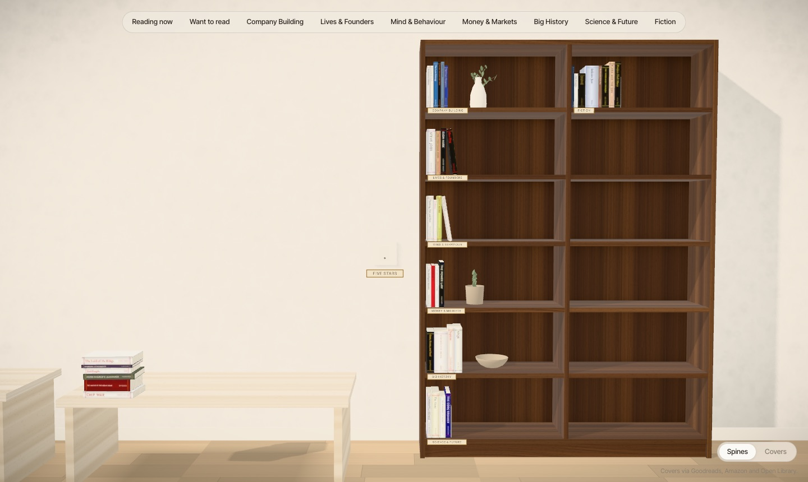
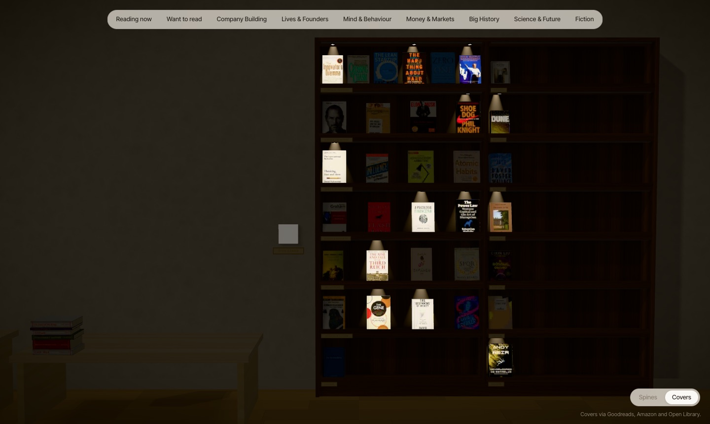

# Bookshelf

Your Goodreads library as a 3D room: a walnut bookcase, a low table with every want-to-read book in stacks, and a small table with the books being read lying open. Every book is sized from its page count and binding and gets a generated spine in its cover colours.

Two views, switched at the bottom right (or with `?view=covers` in the URL):

- **Spines**: one compact bookcase. Categories follow each other shelf by shelf, each starting, where there is one, with a favourite standing face-out.
- **Covers**: every read book face-out on walnut display shelves, in the same order.

A light switch on the wall left of the bookcase, labelled **Five stars**, dims the room and lights your five-star books. In the covers view their spots come on; in the spines view they slide a little out of the shelf.




*Screenshots show the 41-book sample in `fixtures/sample/`.*

Would you rather have Claude Code build your own version from scratch? [PROMPT.md](PROMPT.md) has a prompt that reproduces this project.

As in a library, every category starts in a compartment of its own and every compartment carries a label naming it. Compartments fill down each column, top to bottom, then the next column; spare compartments go to the fullest categories, so there's room to grow. Volumes of a series (numbered series, annual anthologies) stand together in order. The bookcase grows a column when the library outgrows it; no compartment ever takes more books than fit.

Getting around:

| | |
| --- | --- |
| Along the wall | Horizontal scroll or shift + scroll, drag, ← → |
| Up and down the case | Scroll once zoomed in, vertical drag, Page Up / Page Down |
| Zoom | Pinch or ctrl/⌘ + scroll (towards the cursor), double-click to zoom in on a spot, ↑ ↓ |
| A book | Hover to tip it out, click to pull it out, click again to open it; Esc or click outside to put it back |

Vite + React + TypeScript, react-three-fiber, drei, zustand. A Node pipeline turns the Goodreads CSV export into `public/data/books.json`, cover images and a KTX2 spine atlas. The site itself is static.

## Quick start

Try it with the sample library first. It needs no API key, only network access for the covers:

```sh
npm install
npm run data:sample    # builds a 41-book library from fixtures/sample/
npm run dev            # open the URL Vite prints
```

## Your own library

```sh
cp .env.example .env   # then fill in the values below
# put your Goodreads export in data/ (see Data workflow)
npm run data           # build the library from data/*.csv
npm run dev
```

`.env` (git-ignored, read only by the pipeline and never bundled into the client):

| Variable | Purpose |
| --- | --- |
| `ANTHROPIC_API_KEY` | Categorisation with Claude. Only needed when books have no category yet. |
| `GOODREADS_USER_ID` | Number from your profile URL. Enables the list RSS, which supplies covers, page counts and descriptions. |
| `GOODREADS_RSS_KEY` | The `key=` parameter of your RSS link (Goodreads › My Books › RSS). Treat it as a secret. |

## Data workflow

1. **Export** from Goodreads: My Books › Import and export › Export library. Put the CSV in `data/`. The newest `*.csv` is used, and `goodreads_library_export.csv` is preferred if present.
2. **Run** `npm run data`. Steps:
   1. Parse the CSV, then drop hidden books and shelves.
   2. Fetch the Goodreads list RSS for covers, page counts, descriptions and average ratings.
   3. Enrich missing data from the Goodreads book page (often blocked by a bot wall), Open Library and Google Books.
   4. Download covers, in order: override, Goodreads, Amazon (by ISBN), Open Library, Google, then a generated typographic cover.
   5. Extract a colour palette from each cover.
   6. Categorise with Claude (see below).
   7. Compute dimensions in millimetres from pages and binding.
   8. Render spine textures and pack them, and cover thumbnails for the covers view, into KTX2 atlas sheets. Unchanged sheets aren't re-encoded.
   9. Build Goodreads and Amazon links.
   10. Write `public/data/books.json` and print a summary.

   Every HTTP response and per-book result is cached in `data/.cache/`, so reruns only redo what changed. Delete a subfolder there to force a step to rerun. Atlas sheets are named by a hash of their pixels, so a browser can never pair an old cached sheet with a newer `books.json`. With `ATLAS_PNG=1` the pipeline also keeps a PNG of every sheet in `data/.cache/atlas-png/`, for auditing.
3. **Review** the summary. It lists cover sources, books with estimated page counts, and the category distribution.

`npm run data:sample` builds a 41-book sample from `fixtures/sample/` without needing an API key.

## Categories

The first run asks Claude for a taxonomy of 6–9 categories based on the whole library and writes `data/categories.json`. It then assigns every book a primary and an optional secondary category in `data/assignments.json`.

- **Edit `data/categories.json` freely:** rename, reorder (the order is the order of bays on the wall), merge or add. Each entry has `slug`, `name` and `description`.
- **After editing the taxonomy,** delete `data/assignments.json` so books are reassigned against the new list. Or keep it: only books whose assignment no longer matches a slug are sent to Claude again.
- **Claude is called only for books without a valid assignment,** so adding a few books later costs a few calls.

## Overrides

`data/overrides.json`, keyed by Goodreads book id:

```json
{
  "40121378": { "category": "business", "pages": 320, "asin": "B07D23CFGR" },
  "12345": { "coverUrl": "https://example.com/cover.jpg" },
  "67890": { "hide": true }
}
```

| Field | Effect |
| --- | --- |
| `shelf` | Moves a book to `read`, `currently-reading` or `to-read`, whatever the export says. |
| `title`, `author` | Correct a title or author that Goodreads has garbled. It shows on the spine, in the tooltip and in links. |
| `category`, `secondaryCategory` | Beat Claude's assignment. Must be a slug from `categories.json`. |
| `pages` | Fixes the spine thickness. |
| `asin` | Points the Amazon link at that exact product page instead of the ISBN or a search. |
| `amazonSearch` | Links to an Amazon title + author search instead, for books whose ISBN/ASIN page doesn't exist on the marketplace (404). |
| `coverUrl` | Takes precedence over every other cover source. The image is still downloaded and served locally. |
| `hide` | Removes the book from `books.json` at build time. |

## Books not in the export

A book you've just started may not be in your Goodreads export yet. Add it to `data/extra-books.json` with its Goodreads id; it goes through the same pipeline as the rest, and is skipped once the export contains it:

```json
[{ "bookId": "54493401", "title": "Project Hail Mary", "author": "Andy Weir", "isbn13": "9780593135204",
   "binding": "Hardcover", "pages": 496, "yearPublished": 2021, "dateAdded": "2024-01-15", "shelf": "currently-reading" }]
```

Give it a category in `data/assignments.json` (or run with an API key), and a `coverUrl` override if no cover source has one.

## Config flags

Set these as environment variables when running `npm run data`. Defaults are in `pipeline/config.ts`.

| Flag | Default | Meaning |
| --- | --- | --- |
| `SHOW_REVIEWS` | `false` | Include your reviews. When false they are stripped from `books.json`, not merely hidden. |
| `HIDDEN_SHELVES` | `did-not-finish` | Comma-separated shelves (exclusive or custom) whose books are dropped. |
| `FAVOURITES_SHELF` | `favorites` | Custom shelf that marks favourites. |
| `BOOKSHELF_MARKETPLACE` | `amazon.de` | Amazon domain for links. |
| `CLAUDE_MODEL` | `claude-sonnet-5-5` | Model for categorisation. |
| `ATLAS_CODEC` | `etc1s` | `uastc` gives sharper spines at roughly 5× the download size. |

## Privacy

- The page sets `noindex, nofollow`, and `robots.txt` disallows everything.
- There is no analytics and nothing is loaded from third parties. Fonts, covers and the Basis transcoder are self-hosted.
- Reviews, hidden books and hidden shelves never reach the client.
- `.env` and your Goodreads CSV (which holds private notes and unpublished reviews) are git-ignored.
- So is everything the pipeline generates: `public/data/`, `public/covers/` and `public/atlas/`. Your library stays on your machine unless you deploy it. `data/categories.json`, `data/assignments.json` and `data/overrides.json` are not ignored, so you can version your edits; leave them out of commits if your fork is public.

## Development

```sh
npm test             # unit tests: CSV parser, dimension formula
npm run typecheck
npx tsx scripts/screenshots.ts   # Playwright screenshots into screenshots/ (pass the dev server URL; default http://localhost:5317)
npx tsx scripts/hover-audit.ts  # hovers every shelved book in both views and checks the tooltip names it (needs the dev server)
```

Units in the scene are millimetres: x runs along the wall, y is up, and z points out of the wall.

## Deploy

Hosted on Netlify as a static site. The pipeline runs locally (it needs your CSV and API key), so deploy the built output:

```sh
npm run data && npm run build
netlify deploy --prod --dir dist --no-build
```

`netlify.toml` adds `X-Robots-Tag: noindex` to every file, so the JSON and covers stay out of search engines as well as the page.

## Credits and licence

Code: MIT, see [LICENSE](LICENSE).

Bundled third-party files keep their own licences:

- Inter Tight and EB Garamond (`public/fonts/`), SIL Open Font License 1.1.
- Basis Universal transcoder (`public/basis/`), Apache 2.0.

Cover images belong to their publishers. The pipeline downloads them on your machine for your own library; the repo ships none.
